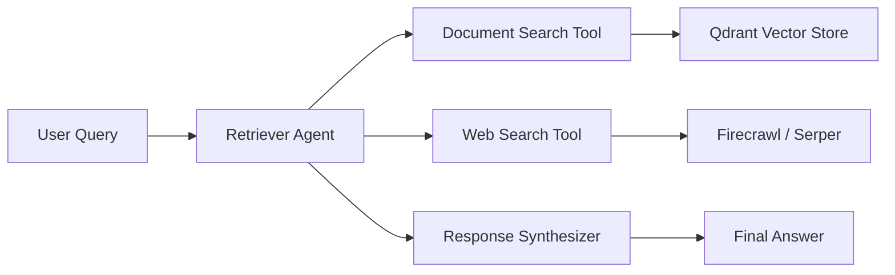

# Agentic RAG

An **Agentic RAG** system built with [CrewAI](https://docs.crewai.com/) that searches your uploaded documents first and falls back to web search when the answer is not in your docs.

Inspired by [patchy631/ai-engineering-hub/agentic_rag](https://github.com/patchy631/ai-engineering-hub/tree/main/agentic_rag), rebuilt with a cleaner structure and a single unified app.

Part of the [AI Agents & Workflows](../) monorepo.

## Features

- **Two-agent crew**: retriever agent + response synthesizer
- **Document search**: PDF ingestion via MarkItDown, semantic chunking (Chonkie), vector search (Qdrant in-memory)
- **Web fallback**: Firecrawl or Serper when document search is insufficient
- **Flexible LLM**: OpenAI cloud models or local Ollama (Llama 3.2, DeepSeek R1)
- **Streamlit UI**: upload PDFs, chat, switch providers from the sidebar

## Architecture



## Prerequisites

- Python 3.11+
- API keys (at least one LLM + one web search provider)
- For local models: [Ollama](https://ollama.com/) running on `http://localhost:11434`

## Setup

```bash
cd "AGENTIC RAG"
python -m venv .venv

# Windows
.venv\Scripts\activate

# macOS / Linux
source .venv/bin/activate

pip install -r requirements.txt
cp .env.example .env   # then fill in your keys
```

Edit `.env` with your keys:

| Variable | Description |
|---|---|
| `LLM_PROVIDER` | `openai` or `ollama` |
| `OPENAI_API_KEY` | Required when using OpenAI |
| `OPENAI_MODEL` | e.g. `gpt-4o-mini` |
| `OLLAMA_MODEL` | e.g. `llama3.2` or `deepseek-r1:7b` |
| `WEB_SEARCH_PROVIDER` | `firecrawl` or `serper` |
| `FIRECRAWL_API_KEY` | From [firecrawl.dev](https://www.firecrawl.dev/) |
| `SERPER_API_KEY` | From [serper.dev](https://serper.dev/) |

## Run

**Streamlit app (recommended):**

```bash
streamlit run app.py
```

**CLI:**

```bash
python -m agentic_rag.main "What is DSPy?" knowledge/sample.pdf
```

## Project Structure

```
AGENTIC RAG/
├── app.py                          # Streamlit UI
├── requirements.txt
├── .env.example
├── knowledge/                      # Sample documents
└── src/agentic_rag/
    ├── crew_factory.py             # Agent + task definitions
    ├── llm_factory.py              # OpenAI / Ollama LLM setup
    ├── main.py                     # CLI runner
    └── tools/
        ├── document_search.py      # PDF → chunks → Qdrant search
        └── web_search.py           # Firecrawl / Serper wrapper
```

## How It Works

1. Upload a PDF in the sidebar (optional).
2. The document is parsed, semantically chunked, and indexed in an in-memory Qdrant collection.
3. When you ask a question, the **retriever agent** tries `DocumentSearchTool` first.
4. If the document does not contain enough context, it uses **web search**.
5. The **synthesizer agent** produces a concise final answer.

## Improvements Over the Reference

- Single unified app instead of three duplicate entry points
- Fixed PDF temp-file bug (uploads persist under `data/uploads/`)
- Configurable LLM and web search providers via `.env` and sidebar
- Modular tool and crew factories for easier extension

## License

MIT
