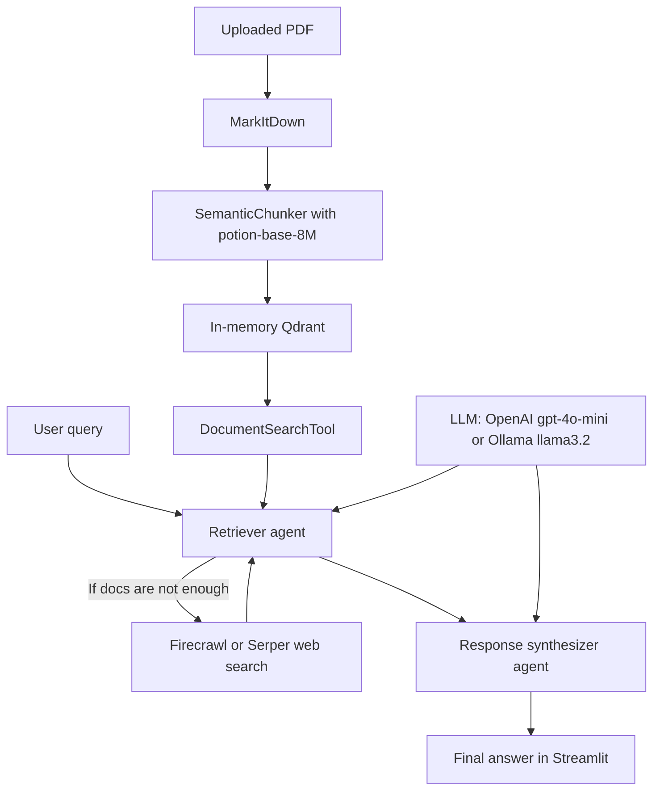
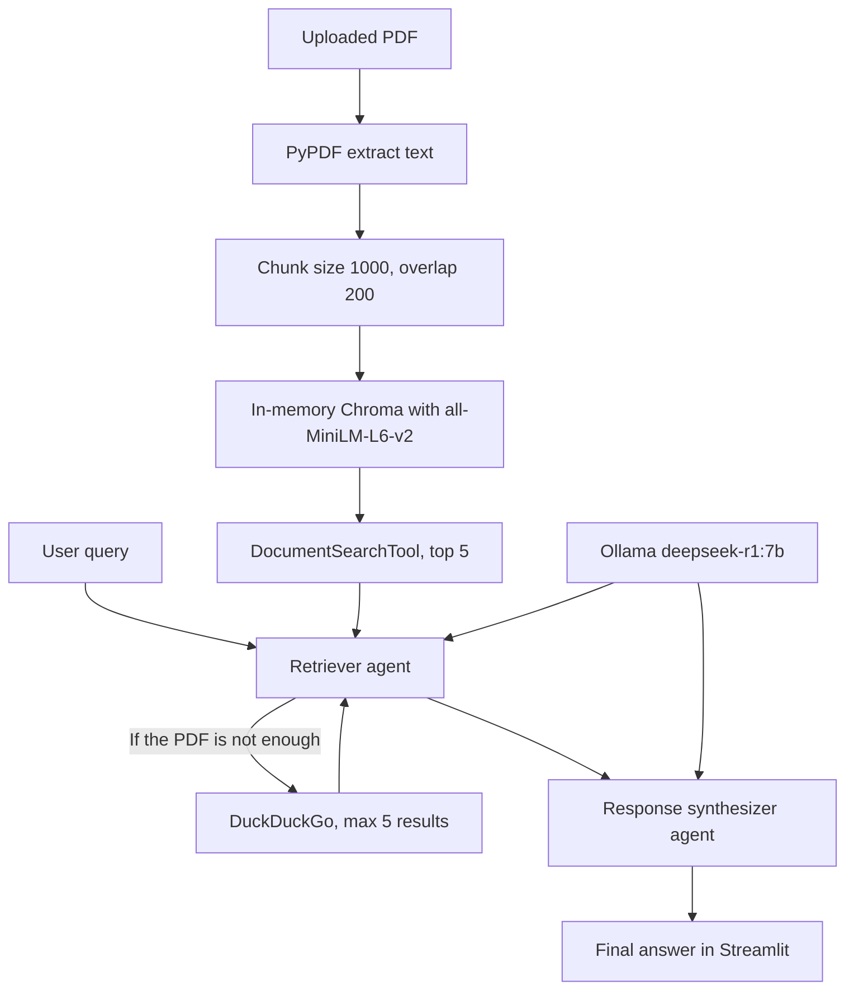
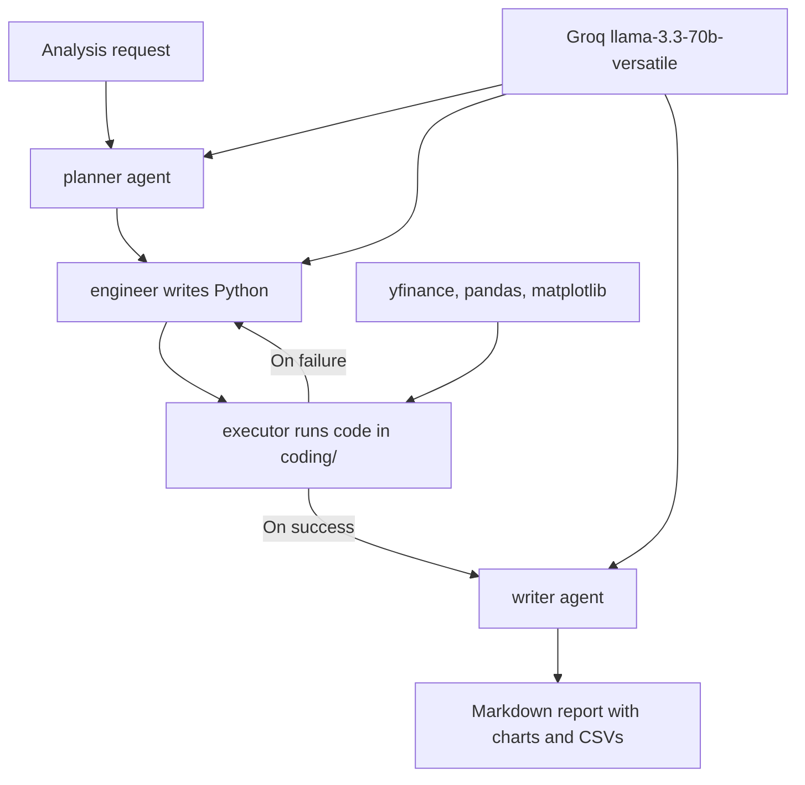
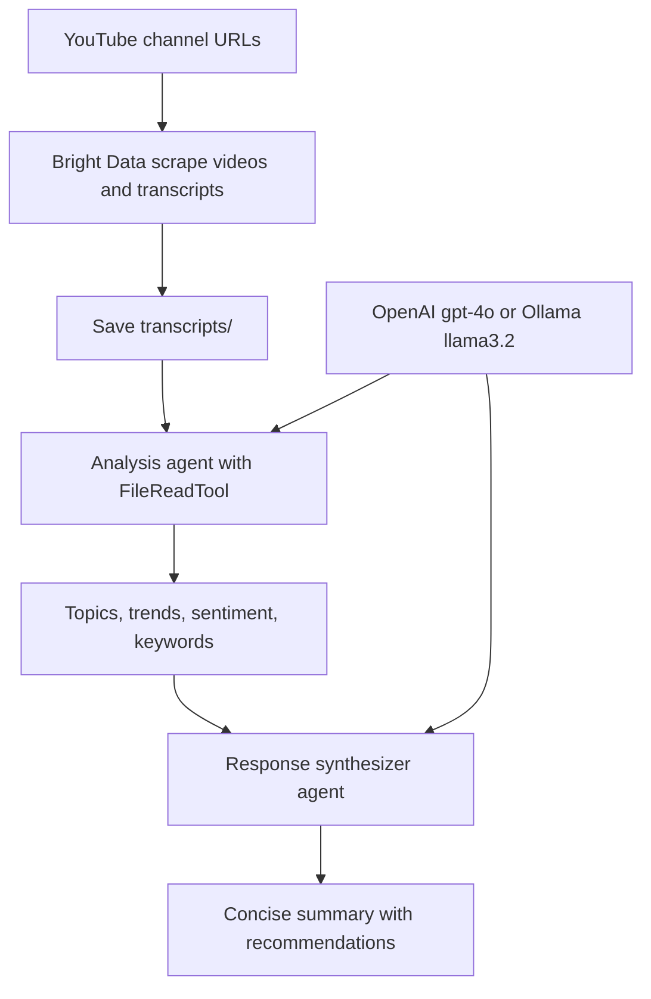
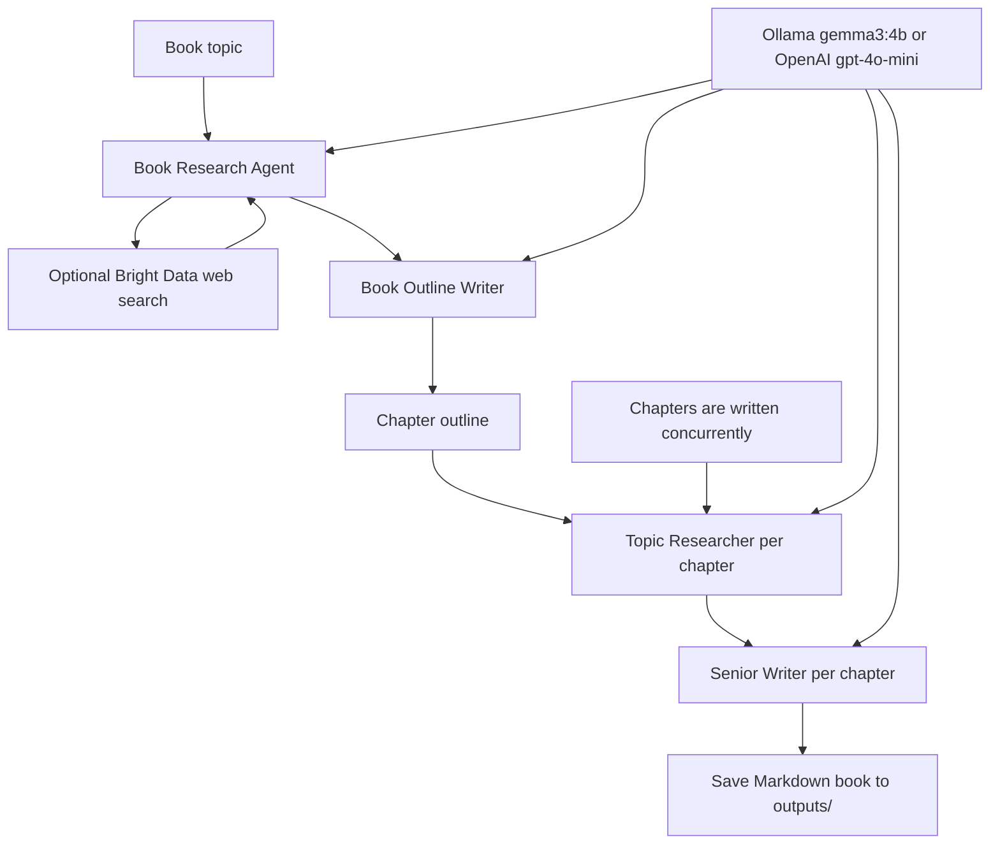

# AI Agents & Workflows

Monorepo for AI agent projects and automated workflows built with [CrewAI](https://www.crewai.com/), [AG2](https://docs.ag2.ai/) (AutoGen), Streamlit, and related tooling.

Each project lives in its own top-level directory with its own dependencies, config, and README.

## Projects

| Project | Description |
|---------|-------------|
| [agentic-rag](./AGENTIC%20RAG/) | Agentic RAG with document search (Qdrant) and web fallback (Firecrawl / Serper), with a Streamlit chat UI |
| [agenticrag-deepseek](./AGENTICRAG_DEEPSEEK/) | Local Agentic RAG with DeepSeek R1 (Ollama), Chroma document search, and DuckDuckGo web fallback |
| [autogen-stock-analyst](./AUTOGEN%20STOCK%20ANALYST/) | Multi-agent stock analysis with AG2 + Groq (free tier), yfinance data, and local code execution |
| [yt-trend-analysis](./YT%20TREND%20ANALYSIS/) | Scrape YouTube channel transcripts via Bright Data and analyze trends with a CrewAI agent crew |
| [book-writer-flow](./BOOK%20WRITER%20FLOW/) | Research a topic and write a complete Markdown book with a concurrent CrewAI flow |

## How it works

### agentic-rag



### agenticrag-deepseek



### autogen-stock-analyst



### yt-trend-analysis



### book-writer-flow



## Getting started

1. Clone the repo:
   ```bash
   git clone https://github.com/Davionnic/AI-Agents-Workflows.git
   cd AI-Agents-Workflows
   ```

2. Pick a project from the table above and follow its README.

3. Copy `.env.example` to `.env` inside that project and add your API keys.

## Adding a new project

1. Create a new directory at the repo root (e.g. `my-new-agent/`).
2. Add a `README.md` with setup and usage instructions.
3. Include a `.env.example` — never commit real secrets.
4. Update the **Projects** table in this file.

## Requirements

- Python 3.11+
- Git

Individual projects may require additional API keys or local services (e.g. Ollama, Groq). See each project's README.
